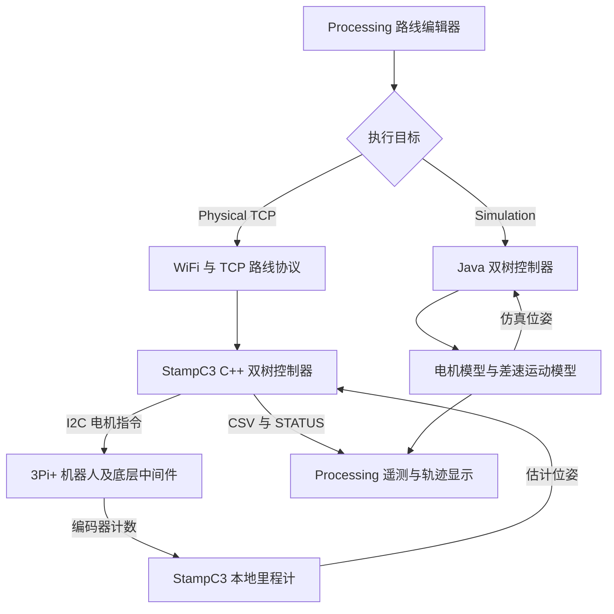

# 双决策树机器人路径跟踪系统技术说明

项目：RoboticsScienceAndSystems-main  
文档版本：1.0  
更新日期：2026 年 11 月 12 日  
适用对象：项目开发者、实验组成员和技术评审人员

## 1 项目目标与实现范围

本项目实现了一套用于二维差速机器人的路径跟踪系统。使用者在 Processing 界面中绘制路线，随后选择在课程运动模型中仿真，或通过 WiFi 和 TCP 将路线发送到 StampC3。控制器根据当前位置和路线几何关系，先由 Tree1 选择运动动作，再由 Tree2 及电机适配逻辑生成左右轮 PWM。

系统的主要用途是让同一组已训练模型在仿真与嵌入式环境中执行，为比较机器人运动轨迹、转弯响应和模型误差提供基础。这里的“同一控制器”指模型权重、几何处理和 PWM 规则保持对应；仿真使用 Java 实现，固件使用 C++ 实现，两者通过数值对照检查一致性。

当前实现具有以下边界。

- 路线由使用者提供，系统执行路线跟踪；没有实现自动避障或全局路径规划。
- 当前闭环定位来自编码器里程计。五路地面传感器保留采集和显示，但未参与双树路径决策；IMU 已初始化，未接入该定位闭环。
- 模型在设备上进行冻结推理，不执行在线训练。Tree2 的训练数据来自合成教师规则。
- 当前工程使用 Processing 二维模型，不依赖 ROS2、Gazebo、OpenCV、Transformer 或 VAE。
- 已保存的闭环仿真报告中，8 条路线有 7 条满足几何终点条件。该结果是特定仿真用例的结果，不是实车成功率。

## 2 系统架构

### 2.1 仿真与实车两条执行路径



实车运动决策在 StampC3 上完成。电脑负责路线编辑、上传、启动停止和数据显示，不需要逐周期通过网络下发 PWM。WiFi 的中断处理和心跳机制负责管理远程会话，运动闭环主要依赖本地编码器反馈。

### 2.2 模块职责

下表中的路径均相对于项目根目录。

| 模块 | 主要文件 | 职责 |
|---|---|---|
| 应用入口 | `DigitalTwin/DigitalTwin.pde` | 创建界面并转发绘图、鼠标和键盘事件 |
| 仿真与显示 | `DigitalTwin/Simulator.pde` | 固定步长更新、视图变换、TCP 连接、遥测图 |
| 路线编辑 | `DigitalTwin/RouteEditor.pde` | 折线绘制、自由画线简化、上传确认、运行控制 |
| Java 控制实现 | `DigitalTwin/TwoTreeController.java` | 重采样、进度、特征、动作和 PWM 计算 |
| Java 模型权重 | `DigitalTwin/TreeModels.java` | 从 C++ 模型导出的权重及配置 |
| 固件入口 | `StampC3_Template/StampC3_Template.ino` | 初始化串口、WiFi、机器人接口和控制器 |
| 固件调度 | `StampC3_Template/Controller.cpp` | 控制周期、网络命令、错误停车和遥测 |
| Tree1 适配 | `StampC3_Template/Tree1PathController.cpp` | 有界路线存储、几何特征、动作推理 |
| Tree2 适配 | `StampC3_Template/Tree2MotorController.cpp` | PWM 差值推理、基准速度、旋转及限幅 |
| 位姿估计 | `StampC3_Template/OdometryModel.cpp` | 将编码器增量积分为本地位姿 |
| 硬件与通信 | `Robot.cpp`、`RobotWifiAP.cpp`、`RouteCommandParser.cpp`，均位于 `StampC3_Template/` | I2C 数据交换、TCP 收发、有界命令解析 |
| 验证与报告 | `tests/`、`simulation-results/` | 宿主测试、跨语言对照、闭环轨迹和报告 |

`Robot_c` 通过 I2C 地址 `0x08` 与机器人侧中间件交换请求和数据。其成员保存最近成功事务的缓存；PWM 缓存代表成功发送的指令，不是测量得到的电机转速。本目录提供 StampC3 端接口和协议定义，实际连接还需要机器人侧运行兼容中间件。

## 3 数据流与坐标约定

### 3.1 从路线到电机

一次正常决策按以下顺序执行。

1. 加载一条完整、已验证的路线，并按 1 mm 间距重采样。
2. 读取左右编码器绝对计数，计算本次增量并更新本地位姿。
3. 将位姿的 X、Y 从毫米转换为米，保持 yaw 的逆时针正方向。
4. 根据当前位姿与路线进度确定前视目标，构造 Tree1 的 11 维输入。
5. Tree1 输出前进、倒车、原地旋转或停车；适配器计算顺时针为正的目标角误差。
6. 前进或倒车时，Tree2 预测右轮减左轮的 PWM 差值，再结合基准 PWM 生成左右轮指令。
7. 通过 I2C 写入 PWM，并发布位姿、传感器及运行状态。

### 3.2 单位与符号

| 数据 | 单位或范围 | 约定 |
|---|---|---|
| 界面路线与本地里程计 X、Y | mm | 世界坐标 +X 向右，+Y 向上 |
| `ROUTE_POINT` 与 Tree1 X、Y | m | 与本地世界坐标轴方向一致 |
| 本地位姿 `theta`、`yaw_ros` | rad | 逆时针为正，零角度面向 +X |
| Tree1 输出 `delta_theta` | rad | 顺时针为正 |
| Tree2 使用的角误差 | rad | 规约到 `(-π, π]`，`-π` 平局映射为 `+π` |
| `previousRight - previousLeft` | PWM 单位 | 上次成功下发的右轮与左轮指令之差 |
| 双树输出左右 PWM | 整数，−100 至 +100 | 正值前进，负值后退，零值停车请求 |
| 编码器计数 | count | 正增量表示对应轮向前运动 |

界面通过 Y 轴翻转将屏幕坐标转换为世界坐标。不能直接把鼠标像素 Y 当作机器人世界 Y；缩放和平移也必须参与换算。`yaw_ros` 是字段名称，不表示本工程运行了 ROS。

正的顺时针角误差要求左轮比右轮更快。因此，在相同上一周期轮 PWM 的条件下，顺时针转向通常对应负的右减左差值。调试时应同时检查角度正方向、差值定义和轮子编号。

## 4 路线表示与 Tree1

### 4.1 路线输入与容量

路线是有序二维控制点序列。Points 模式逐点绘制；Freehand 模式采集轨迹后使用迭代式 Ramer–Douglas–Peucker 简化，初始容差为 2 mm，点数过多时进一步增大容差。实际加载的是简化后显示的折线，应以显示结果为准。

| 参数 | 当前值 | 所在位置 |
|---|---:|---|
| 上传控制点数量 | 2 至 256 | `RouteCommandParser.h` |
| 单点坐标绝对值上限 | 10 m | `RouteCommandParser.h` |
| 上传路线总长上限 | 4 m | `RouteCommandParser.h` |
| 界面允许的最短路线 | 1 mm | `RouteEditor.pde` |
| 重采样间距 | 0.001 m | `tree1_config.hpp` |
| 重采样容量 | 4096 点 | `Tree1PathController.h` |
| 前视距离 | 0.02 m | `tree1_config.hpp` |
| 几何终点容差 | 0.005 m | `tree1_config.hpp` |
| 向前搜索窗口 | 3000 个索引间隔 | `tree1_config.hpp` |

相邻重复点会被跳过，重采样间距跨折线顶点连续累计，并保留终点。全部点重合、非有限坐标、非法配置或容量不足都会使加载失败，并卸载旧路线，防止意外继续执行旧路径。

C++ 中的重采样坐标和累计距离使用固定数组，三组 4096 个 `double` 共占 98,304 字节，即 96 KiB；这还不包含控制器的其他成员。固件将控制器放在全局存储区，不能把该对象随意改成任务栈上的大型局部变量。

### 4.2 连续进度保护

在闭合路线或交叉路线中，几何位置接近的两个点可能属于不同的执行阶段。直接选择搜索窗口内最近的点，可能跳到后续分支。

默认 `ProgressMode::Continuous` 使用以下约束：首次定位寻找向前搜索中的第一个局部距离最小位置；后续进度只向前推进，并受实际位移和有限累计额度约束。每次观测以位移的两倍增加可推进距离，未用额度受前视距离等参数限制，避免机器人静止时通过反复调用逐步跳完整条闭合路线。

`SourceCompatible` 模式保留原始向前窗口最近点搜索，供与独立 Tree1 实现对照。连续进度保护改变的是几何适配行为，不修改树权重，也不能替代定位精度验证。

### 4.3 特征构造

在已确定进度附近，适配器沿重采样路线累计距离，选择约 20 mm 前方的目标。目标不足 20 mm 时使用路线终点。设目标相对机器人的世界坐标位移为 `(vx, vy)`，局部路线单位切向量为 `(tx, ty)`，则特征顺序如下。

| 索引 | 特征名 | 含义 |
|---:|---|---|
| 0 | `vector_x` | 目标 X 减当前位置 X，m |
| 1 | `vector_y` | 目标 Y 减当前位置 Y，m |
| 2 | `distance` | 到前视目标的欧氏距离，m |
| 3 | `tangent_x` | 路线单位切向量 X 分量 |
| 4 | `tangent_y` | 路线单位切向量 Y 分量 |
| 5 | `heading_error` | 考虑几何倒车判定后的目标航向误差，rad |
| 6 | `tangent_heading_error` | 路线切向与车头的航向误差，rad |
| 7 | `goal_distance` | 当前位姿到最终终点的直线距离，m |
| 8 | `remaining_distance` | 从进度索引到终点的累计路线距离，m |
| 9 | `abs_heading_error` | 索引 5 的绝对值 |
| 10 | `abs_tangent_heading_error` | 索引 6 的绝对值 |

其中位移向量使用世界坐标，没有先旋转到机器人坐标系。几何倒车判定依据切向航向误差是否超过 90°；最终动作仍由树输出决定。动作确定后，适配器再计算交给 Tree2 的 `delta_theta`，不能把它与输入特征 `heading_error` 在所有动作下视为同一个量。

### 4.4 动作和停车条件

`tree1_model.hpp` 是从 River HAT 导出的冻结分类模型，输出 `FORWARD`、`REVERSE`、`ROTATE` 或 `STOP`。模型设备端不进行增量学习。

几何终点条件要求以下两项同时成立：

$$
d_{goal} \leq 0.005\ \mathrm{m}, \qquad s_{remaining} \leq 0.005\ \mathrm{m}.
$$

满足时适配器强制输出 STOP。不过，分类树也可能在该条件满足前输出 STOP，因此“电机已经停车”不等于“已经通过终点验收”。`terminal` 字段专门记录几何条件，实验时应与动作分开使用。

配置中保留了训练时的 `rotate_threshold_deg = 75`，但部署动作来自树的已学习分裂阈值。修改这个配置字段不会自动把已导出的树改成精确的 75° 规则。

## 5 Tree2 与左右轮 PWM

### 5.1 输入和输出

Tree2 的三个输入为顺时针角误差、运动方向和上一周期右减左 PWM。输出是请求的右减左 PWM 差值，不是两轮转速，也不是两个独立的 PWM 预测。

当前模型深度为 4，包含 16 个线性叶节点。叶内线性计算使用常数项、角误差、方向和除以 255 的上一周期 PWM 差值。训练报告记录了 24 个合成会话、6144 条样本；验证按会话划分为 18 个训练会话和 6 个验证会话，避免同一会话同时进入两个集合。

### 5.2 左右镜像约束

令原始树预测为 `f(e, q, d)`，其中 `e` 为角误差、`q` 为前进或倒车方向、`d` 为上一周期右减左 PWM，则部署预测为：

$$
\widehat{\Delta p}=\frac{f(e,q,d)-f(-e,q,-d)}{2}.
$$

该规则使左右镜像输入得到反号差值。在 `e = 0` 且上一周期两轮 PWM 相等时，预测差值严格为零；如果上一周期两轮 PWM 不相等，零角误差不保证马上输出零差值。该约束假设左右系统对称，后续使用不对称电机实测数据时需要重新评估。

### 5.3 基准 PWM 与限幅

前进基准为 +45，倒车基准为 −35。实际基准会随转角和终点距离降低。令 `clip` 表示限幅，`e` 为规约后的角误差，则当前代码等价于：

$$
b=b_0\,\mathrm{clip}(\cos e,0,1)
\,\mathrm{clip}\left(\frac{\max(d_{goal},s_{remaining})}{0.02},0,1\right).
$$

使用终点直线距离和剩余路线距离的较大值，可以避免闭合路线起点与终点接近时立即按终点距离减速。随后为左右轮保留共同余量：

$$
D_{max}=2(100-|b|),\qquad
D=\mathrm{clip}(\widehat{\Delta p},-D_{max},D_{max}).
$$

$$
p_L=\operatorname{round}(b-D/2),\qquad
p_R=\operatorname{round}(b+D/2).
$$

最终两轮均限制在 −100 至 +100。先限制差值再分配左右轮，可以避免分别截断两轮时额外改变请求的平均 PWM。

### 5.4 原地旋转与停车

ROTATE 不进入 Tree2 回归模型，而是使用独立转向规则：

$$
u=\mathrm{clip}(45e,-35,35),\qquad p_L=\operatorname{round}(u),\quad p_R=\operatorname{round}(-u).
$$

STOP 直接请求两轮输出零。Tree1 的方向信号把 ROTATE 和 STOP 都映射为 0，而 Tree2 训练排除了方向为 0 的样本，所以调用方必须根据动作枚举区分旋转和停车。

当前系统包含学习模型、几何计算、减速规则和故障处理。描述实现时应保留这些组成部分，不能把所有控制行为都归因于两棵树本身。

## 6 编码器里程计与控制周期

### 6.1 位姿更新

`OdometryModel_c` 默认参数为轮半径 16 mm、轮距 90 mm、每轮转一圈 358.3 个编码器计数。这些是待校准的起始值。

设左右计数增量为 `ΔnL` 和 `ΔnR`，左右轮半径为 `rL` 和 `rR`，每圈计数为 `N`，轮距为 `B`：

$$
\Delta s_L=\frac{2\pi r_L\Delta n_L}{N},\qquad
\Delta s_R=\frac{2\pi r_R\Delta n_R}{N}.
$$

$$
\Delta s=\frac{\Delta s_L+\Delta s_R}{2},\qquad
\Delta\theta=\frac{\Delta s_R-\Delta s_L}{B}.
$$

位置采用一阶欧拉积分，先使用旧航向更新 X、Y，再累加航向：

$$
x_{k+1}=x_k+\Delta s\cos\theta_k,\quad
y_{k+1}=y_k+\Delta s\sin\theta_k,\quad
\theta_{k+1}=\theta_k+\Delta\theta.
$$

编码器增量已经代表本次采样间隔内的运动量，这里不再额外乘以时间间隔。首次有效读数只建立计数基线，不累计位移。计数差处理了有符号 32 位回绕，前提是相邻读数之间运动量小于半个计数器量程。

`robot.getPose()` 获取的机器人侧位姿目前仅作为诊断缓存。双树使用 StampC3 自己通过编码器计算的位姿。Reset pose 清零该本地估计并重新建立计数基线，不会把真实机器人移动回原点。

### 6.2 调度参数

| 工作项 | 标称间隔 | 标称频率 |
|---|---:|---:|
| 实车传感器和里程计更新 | 10 ms | 100 Hz |
| 双树决策与运动 PWM 更新 | 50 ms | 20 Hz |
| 实车 CSV 遥测 | 50 ms | 20 Hz |
| 周期性 STATUS | 250 ms | 4 Hz，状态变化时可提前发送 |
| GUI 心跳 PING | 500 ms | 2 Hz |
| GUI 命令或回复超时 | 2500 ms | 不适用 |
| 固件有效命令超时 | 3000 ms | 不适用 |

固件采用循环和定时器检查，这些是标称周期，不是硬实时执行时间保证。网络输入每次最多处理 512 字节；发送使用非阻塞 socket 调用，部分发送或发送失败会断开会话，避免残缺 ACK 后继续运行。

## 7 通信协议与运行状态

### 7.1 连接和命令

当前固件配置的 AP 名称为 `myAP`，示例密码为 `myPassword`；Processing 客户端连接 `192.168.4.1:80`。80 端口承载按行分隔的 ASCII TCP 协议，并未实现 HTTP 网页服务。协议接受 LF 或 CRLF，单行内容最多 127 字节。

| 命令 | 功能 | 成功响应 |
|---|---|---|
| `STOP` | 请求零 PWM，取消未完成上传，重置进度 | `ACK STOP` |
| `RESET_POSE` | 先停车，再归零本地里程计 | `ACK RESET_POSE` |
| `ROUTE_BEGIN n` | 停车并开始接收 n 个控制点 | `ACK ROUTE_BEGIN n` |
| `ROUTE_POINT x y` | 接收一个以米为单位的路线点 | `ACK ROUTE_POINT k`，k 为已收到点数 |
| `ROUTE_END` | 检查点数并提交完整路线 | `ACK ROUTE_END n` |
| `START` | 启动已就绪路线 | `ACK START` |
| `PING` | 保持会话并确认通信，不修改路线 | `ACK PING` |

失败响应格式为 `ERR <命令> <原因>`。坐标不接受 NaN、无穷大、十六进制数字或尾随文本。解析器按字节处理 TCP 拆包和合包；超长或非法输入会丢弃到下一行结束。

以下为一条 200 mm 直行后向 +Y 移动 150 mm 的路线。实际客户端应逐条等待并核对 ACK，再发送下一条路线指令。

```text
STOP
RESET_POSE
ROUTE_BEGIN 3
ROUTE_POINT 0.000000 0.000000
ROUTE_POINT 0.200000 0.000000
ROUTE_POINT 0.200000 0.150000
ROUTE_END
START
```

### 7.2 状态与停止语义

固件内部使用 `WAITING`、`FOLLOWING_PATH` 和 `STOPPED` 三种状态；STATUS 将运行中的 `FOLLOWING_PATH` 显示为 `RUNNING`。

| 事件 | 运行结果 | 路线和定位处理 |
|---|---|---|
| 完整路线成功提交 | WAITING | 进度重置，保留当前位置 |
| 有效 START | RUNNING | 从已重置的路线进度开始执行 |
| 正常 STOP | WAITING | 已上传路线通常保留，进度重置，定位保留 |
| RESET_POSE | WAITING | 进度重置，本地位姿归零 |
| Tree1 输出 STOP | STOPPED | 停车；是否完成需另外检查几何条件 |
| 编码器、模型或电机事务故障 | STOPPED | 撤销远程启动资格，后续周期重试零 PWM |
| 断线、心跳超时或命令被拒绝 | 请求停车 | 撤销远程启动资格，需要完整重传 |

STOP 的语义是停止并重置进度，不是保留进度的暂停。自然完成后的实车状态为 STOPPED，不能直接重新 START；需要明确 STOP、Reset pose 或重新上传，使状态恢复到可启动条件。重新进行可比实验时，应把机器人摆回相同物理起点，再重置位姿。

第一次软件连接会接管远程控制。此后硬件按钮不能重新启动路线；未被软件接管时，按钮可启动 `AIPath.h` 中的离线示例。

软件停车最终依赖电机指令送达。I2C 总线失效时，反复请求零 PWM 不能证明机器人已物理停止。协议确认、实际运动状态和实验现场停止方式应分别验证。

### 7.3 遥测字段

正常遥测为无表头的 14 列 CSV，TCP 和串口使用相同字段顺序。

| 列号 | 字段说明 | 单位或取值 |
|---:|---|---|
| 1 | 时间戳 | ms |
| 2 | 本地 X | mm |
| 3 | 本地 Y | mm |
| 4 | 本地 yaw | rad，逆时针为正 |
| 5 | 左轮请求 PWM | 整数 |
| 6 | 右轮请求 PWM | 整数 |
| 7 | 左轮绝对编码器计数 | count |
| 8 | 右轮绝对编码器计数 | count |
| 9 至 13 | DN1 至 DN5 地面传感器 | 原始读数 |
| 14 | 控制器启动信号 `signal` | 通常为 0 或 1 |

最后一列不是 Tree1 的前进或倒车方向，也不能单独作为“正在运动”的判据：自然停车或部分故障停车后，它可能仍保持为 1。运行状态应同时查看 STATUS 的 `mode`、`action`、`route_ready` 和 `error`。

STATUS 示例格式如下，数值仅用于说明字段：

```text
STATUS mode=RUNNING route_ready=1 action=FORWARD progress=120 points=351 error=none
```

`progress` 是重采样索引，`points` 是重采样点数，不能直接解释为百分比或上传控制点数量。STATUS 和 ACK/ERR 也不是 14 列 CSV，离线解析日志时应先按行类型分开。

## 8 仿真模型与实车对应关系

### 8.1 固定步长运动模型

Processing 物理更新步长为 10 ms，双树控制周期为 50 ms。界面帧率与物理步长分离；发生长时间界面停顿时，最多补算 10 步，不能把显示刷新时间直接当作完整仿真时间。

电机模型将 PWM −200 至 +200 线性映射到轮速 −0.25 至 +0.25 mm/ms。由于双树输出限制为 ±100，当前闭环实际使用的理想轮速最大值为 0.125 mm/ms，即 125 mm/s。前进基准 45 PWM 在未减速时对应 56.25 mm/s。这些均为模型计算值，不是实测速度。

仿真位姿由该模型的轮位移积分产生，控制器直接读取这一位姿。仿真没有完整复现实车 I2C 获取、编码器整数采样、里程计漂移或通信故障，因此模型权重一致不代表完整硬件执行过程一致。

### 8.2 地面传感器模型

仿真传感器以机器人中心为参考，位于 45 mm 半径处，角度依次为 +45°、+14°、0°、−14°、−45°。地面图像按 1 pixel/mm 采样，亮度线性映射为黑色 2000、白色 400，图像范围外返回 400。

这是一种理想点采样模型，没有实测传感器的覆盖面积、非线性、饱和、噪声和时延。地图黑线用于地面传感器采样，双树路径来自绘制路线；更换黑线图案不会自动改变双树路线。

### 8.3 对照时需要区分的量

| 对照对象 | 当前可以检查的内容 | 解释限制 |
|---|---|---|
| C++ 与 Java 控制器 | 同输入下的动作、索引、几何量和 PWM | 验证实现一致性，不验证实车动力学 |
| 仿真与实车 PWM | 指令时序、差值、转弯时的变化 | PWM 相同不保证轮速相同 |
| 仿真轨迹与实车里程计 | 内部估计的运动差异 | 实车里程计不是真实位置基准 |
| 实车轨迹与外部位置观测 | 独立测量的路径误差 | 需要统一尺度、坐标和时间 |
| 仿真与实车地面读数 | 黑白过渡位置及读数变化 | 需要传感器位置和响应模型校准 |

当前界面提供轨迹和时间序列显示，但没有完整的实验日志导出及统计评估流程。显示图像可以辅助判断，正式对比仍需保存原始数据并采用统一指标。

## 9 运行与构建

### 9.1 启动仿真

在项目根目录的 PowerShell 中执行：

```powershell
.\RunSimulation.ps1
```

脚本默认使用 `.tools/processing4/Processing` 中的 Processing 4.5.7。也可指定实际安装目录，或仅检查草图构建：

```powershell
.\RunSimulation.ps1 -ProcessingRoot 'C:\path\to\Processing'
.\RunSimulation.ps1 -BuildOnly
```

上述路径是需要替换的示例。也可直接用 Processing 4 打开 `DigitalTwin/DigitalTwin.pde`；如缺少 `processing.net`，需提供相应 Network 库。

界面默认处于 Simulation。依次选择 **Square demo → Reset pose → Load into sim → START**。方形示例实际为 200 mm × 160 mm 的闭合矩形。可用 Points 或 Freehand 替换路线；STOP 或空格停车，G 显示遥测图，T 跟踪小车，滚轮缩放，中键拖动或方向键平移。

### 9.2 固件构建与实车操作

`platformio.ini` 指定 Arduino 框架、`espressif32@6.8.1`、`esp32-c3-devkitm-1` 构建目标和 C++17，依赖 LSM6 与 LIS3MDL 库。配置的默认上传和监视端口是 COM6，串口监视速率为 115200；实际设备端口需要单独确认。

仅编译固件：

```powershell
pio run -e stampc3
```

确认目标板与串口后，烧录命令为：

```powershell
pio run -e stampc3 -t upload --upload-port COM6
```

烧录输出为 `.pio/build/stampc3/firmware.bin`。此命令针对 StampC3，不应把它当作 3Pi+ 32U4 底层固件的烧录命令。

运行实车时，连接机器人 AP，将机器人放在约定原点并面向 +X，选择 **Physical TCP**，静止时执行 **Reset pose**，然后 **Upload route → START**。切换 Simulation 与 Physical TCP 前须停止当前运行，切换后重新加载或上传路线。默认仿真模式不主动连接实车。

当前固件只向 USB 串口输出遥测，没有实现串口接收路线命令的处理循环。打开串口终端能看到 CSV，不代表可以从该串口输入 START 来启动这份固件的路线控制。

### 9.3 宿主检查与模型同步

C++ 宿主检查需要 CMake、C++17 编译器，以及项目外部的原始 `first_tree` 目录。该目录必须包含 `cpp/tree1_runtime.hpp`，用于独立几何对照。例如：

```powershell
cmake -S . -B build-host '-DTREE1_SOURCE_DIR=C:/path/to/first_tree'
cmake --build build-host --config Release
ctest --test-dir build-host -C Release --output-on-failure
```

`C:/path/to/first_tree` 必须替换成实际路径。默认相对位置为项目根目录的 `../../../first_tree`；移动工程后该默认值不一定仍有效。已复制的 `build-host/CMakeCache.txt` 还可能绑定旧源码目录，需要重新配置适合当前路径的构建目录。

完整 Processing 检查由下列脚本执行，Python 需指向可用的解释器：

```powershell
python tests/run_processing_simulation_checks.py
```

该脚本构建真实 Processing 草图，执行闭环路线、Java/C++ 对照、界面逻辑和 CTest，并写入 `simulation-results/`。脚本及跨语言检查固定引用 `build-host`，因此运行前应确保该目录可在当前工程路径下正确配置。退出码 2 表示测试已完成，但至少一条路线未通过终点条件；其他构建或断言错误会中止检查。

修改 C++ 模型权重后，需要同步 Java 导出：

```powershell
python tools/export_processing_models.py
```

随后重新执行相关构建和对照检查。`TreeModels.java` 记录三份 C++ 源头文件的 SHA256，不能只手改 Java 权重。当前工程保存部署头文件与训练报告，Tree1、Tree2 的原始训练工程和 Tree2 数据 CSV 位于外部目录；单独复制本目录不足以完整复现训练。

## 10 已有验证结果

### 10.1 闭环仿真

`simulation-results/report.json` 记录的测试时间为 2026 年 10 月 19 日 UTC，平台为 Processing 4.5.7 的真实 Java 模式编译器和课程 PDE 运动模型。结果如下，距离保留三位小数。

| 路线 | 几何终点通过 | 仿真时间 s | 终点距离 mm | 停车原因 |
|---|---|---:|---:|---|
| 直线 | 是 | 5.50 | 4.750 | 到达终点 |
| 直角 | 是 | 7.70 | 4.901 | 到达终点 |
| 闭合矩形 | 是 | 15.45 | 4.903 | 到达终点 |
| S 形折线 | 是 | 9.90 | 4.818 | 到达终点 |
| 交叉路线 | 否 | 18.25 | 5.060 | Tree1 在几何终点前输出 STOP |
| 初始朝向反向并倒车 | 是 | 7.05 | 4.875 | 到达终点 |
| 初始原地转向 | 是 | 6.60 | 4.412 | 到达终点 |
| 含重复控制点 | 是 | 6.30 | 4.752 | 到达终点 |

交叉路线最终直线距离为 5.059894 mm，剩余路线距离为 3.116882 mm。它没有通过“两个距离均不超过 5 mm”的几何判据，因此应保留为失败，不能仅因超差较小就改写为通过。

测试代码的完整成功条件是控制器已停止、`terminal == true`，并且最终记录位置到终点的距离不超过 5.1 mm。这里的 5.1 mm 是最终位置检查的数值余量；`terminal` 仍由控制器内部的 5 mm 双条件产生，交叉路线因此仍为失败。

### 10.2 实现一致性与模型验证

| 验证项 | 保存的结果 | 能支持的结论 |
|---|---|---|
| Java/C++ 对照 | 11,070 组，离散项零差异，连续量最大误差约 1.78 × 10⁻¹⁵ | 指定用例上的几何、动作和 PWM 实现对应 |
| Processing 界面逻辑 | 86 项通过 | 对实际 PDE 源码的无窗口逻辑检查通过 |
| C++ 宿主检查 | 3 组通过 | 模型、控制周期与命令解析相关回归检查通过 |
| Tree2 合成验证集 | PWM 差值 MAE 为 4.1913，旧模型同划分为 6.6561 | 对合成教师规则的拟合误差下降约 37.03% |
| Tree2 Python/C++ 对照 | 25,384 组通过，最大绝对误差约 1.39 × 10⁻⁵ PWM | 保存的部署导出与训练端预测对应 |

11,070 组对照不是 11,070 次独立实车试验，86 项逻辑检查也不是完整 GUI 渲染验收。应按照各测试实际覆盖的层级解释结果。

2026 年 11 月 12 日编写本文时，已核对报告列出的 12 份 Processing 源文件，SHA256 均与当前文件一致；Java 导出中记录的三份 C++ 模型及配置哈希也与当前文件一致。本次文档整理未重新执行完整构建、闭环测试或实车运行，不将历史报告日期改写为本次测试日期。固件硬件接口等未包含在该仿真源码哈希清单中的文件，不属于这项一致性结论的覆盖范围。

## 11 仿真与实车对比的实验建议

本节给出后续实验设计，不表示相关实车数据或统计功能已经完成。

### 11.1 固定实验条件

优先选定直线和单个 90° 转弯，再扩展到闭合与交叉路线。每组仿真和实车运行应使用相同的控制点、模型版本、标称控制周期、起点和初始朝向。固定电池状态范围、地面材料和负载，记录轮半径及轮距设置。建议每个条件至少重复 5 次，保留失败运行及其原因。

位姿归零必须与真实摆放位置配合。若实际车辆尚未回到原点，单独按 Reset pose 只会改变坐标估计，不能建立相同的物理初始条件。

### 11.2 转弯后振荡的测量

为每个转弯预先定义转弯结束事件和后续直线段。可使用进入出弯直线段的投影位置作为比较基准，同时保存相对时间。不要直接用两个程序的启动时间戳相减，因为仿真与实车时钟不同。

| 指标 | 建议定义 | 需要的数据 |
|---|---|---|
| 横向误差 | 相对出弯直线段的有符号垂距 | 参考线段和 X、Y |
| 横向误差 RMS | 预定义出弯区间内横向误差平方均值的平方根 | 等时间间隔样本，或明确的时间加权 |
| 最大超调 | 转弯后相对目标直线的最大绝对横向偏移 | 同一观测窗口 |
| 稳定时间 | 首次进入设定误差带且连续保持规定时间的时刻 | 误差阈值、保持时间、时间戳 |
| 振荡次数 | 去除预定噪声带后横向误差的有效过零次数 | 带符号误差和噪声阈值 |
| 转向指令变化 | `pwmRight - pwmLeft` 的变化及换向次数 | 两轮 PWM 和时间戳 |
| 终点表现 | 终点位置误差、到达时间、是否几何完成 | 最终位置、路线进度和状态 |

例如，可以在实验前约定稳定误差带为 ±5 mm、持续时间为 0.5 s；这些只是建议的实验设置，需按测量分辨率确定，不能事后为通过结果调整。若没有观察到稳定，应记录未稳定或超时。

同时分析角误差、动作切换和 PWM 差值，有助于区分可能的振荡来源，包括模型叶节点切换、上一周期差值保留、低 PWM 死区、时延和里程计误差。当前结果不能直接证明其中哪一项是实车振荡主因。

### 11.3 日志与独立测量

已有仿真轨迹 CSV 记录 `t_ms,x_mm,y_mm,yaw,left_pwm,right_pwm,action,progress`。实车正常 CSV 不包含角误差、`terminal` 或完整动作字段，STATUS 又使用不同周期。因此若需要逐周期比较这些量，建议增加专门的实验日志格式，或编写能按时间关联 CSV 与 STATUS 的记录器；不要把未记录的量当作已有实测字段。

实车里程计适合检查控制器内部看到的状态，但不能独立证明真实路径精度。外部位置基准可以使用俯视相机、标尺或固定标记；若使用视觉，应先统一尺度与坐标，再比较实际轨迹。视觉可先用于测量，不必接入实时控制闭环。

传感器异常宜单独进行静态黑白参考和运动过渡实验。在传感器没有参与当前双树决策的情况下，应先检查其采样与通信，避免未经验证就把传感器波动解释为路径振荡原因。

## 12 当前限制与维护重点

当前最需要补足的是实车参数校准与可重复测量。理想 PWM 轮速关系没有电机死区、摩擦、打滑、左右差异、电池电压和执行时延；只调整模型复杂度不足以消除这些差异。

| 项目 | 当前影响 | 后续处理方向 |
|---|---|---|
| Tree1 提前 STOP | 少数路线可能停车但未满足几何验收 | 保留独立 `terminal` 判据，检查终点样本与分类边界 |
| Tree2 合成训练 | 模型拟合教师规则，不等于学习了实车动力学 | 采集带会话标识的实测数据，再验证与导出 |
| 镜像对称假设 | 难以表达明显的左右硬件不对称 | 用实测对照判断是否保留该约束 |
| 编码器漂移 | 内部轨迹可能与实际轨迹不同 | 校准轮参数，并增加独立位置测量 |
| 定时与总线差异 | 实车周期可能偏离理想仿真步长 | 日志记录实际时间间隔和事务失败 |
| 控制输出为整数 PWM | 低速区量化可能影响末端响应 | 检查小角度、小 PWM 和实际启动死区 |
| 实验记录不完整 | 界面观察不能直接形成可重复统计 | 保存完整原始日志、路线、版本和条件 |

下一阶段适合围绕一个固定控制版本开展小规模实车与仿真对照：先校准基础运动参数，再量化直角转弯后的误差和振荡，最后根据证据修改具体模型或适配规则。

## 13 源码与报告索引

以下索引用于核查本文中的实现和结果。修改对应文件后，应同步更新相关说明；历史结果仍保留原测试日期。

| 说明内容 | 主要依据 |
|---|---|
| 固件调度与状态 | [Controller.cpp](../StampC3_Template/Controller.cpp)、[Controller.h](../StampC3_Template/Controller.h) |
| 路线重采样与进度 | [Tree1PathController.cpp](../StampC3_Template/Tree1PathController.cpp)、[Tree1PathController.h](../StampC3_Template/Tree1PathController.h) |
| Tree1 权重与特征 | [tree1_model.hpp](../StampC3_Template/tree1_model.hpp)、[tree1_config.hpp](../StampC3_Template/tree1_config.hpp) |
| Tree2 与 PWM 规则 | [Tree2MotorController.cpp](../StampC3_Template/Tree2MotorController.cpp)、[Tree2Model.h](../StampC3_Template/Tree2Model.h) |
| Tree2 数据和验证指标 | [Tree2TrainingReport.json](../StampC3_Template/Tree2TrainingReport.json) |
| 编码器积分 | [OdometryModel.cpp](../StampC3_Template/OdometryModel.cpp)、[OdometryModel.h](../StampC3_Template/OdometryModel.h) |
| TCP 协议与硬件接口 | [RouteCommandParser.cpp](../StampC3_Template/RouteCommandParser.cpp)、[RobotWifiAP.cpp](../StampC3_Template/RobotWifiAP.cpp)、[Robot.cpp](../StampC3_Template/Robot.cpp) |
| Java 控制与权重同步 | [TwoTreeController.java](../DigitalTwin/TwoTreeController.java)、[TreeModels.java](../DigitalTwin/TreeModels.java)、[导出脚本](../tools/export_processing_models.py) |
| 仿真动力学 | [RobotSimulation.pde](../DigitalTwin/RobotSimulation.pde)、[MotorsModel.pde](../DigitalTwin/MotorsModel.pde)、[OdometryModel.pde](../DigitalTwin/OdometryModel.pde) |
| 地面模型与界面 | [SurfaceSensorModel.pde](../DigitalTwin/SurfaceSensorModel.pde)、[Simulator.pde](../DigitalTwin/Simulator.pde)、[RouteEditor.pde](../DigitalTwin/RouteEditor.pde) |
| 终点验收与历史结果 | [ProcessingSimulationTests.java](../tests/ProcessingSimulationTests.java)、[report.json](../simulation-results/report.json)、[测试日志](../simulation-results/latest-test.log) |
| 构建入口 | [platformio.ini](../platformio.ini)、[CMakeLists.txt](../CMakeLists.txt)、[RunSimulation.ps1](../RunSimulation.ps1) |

